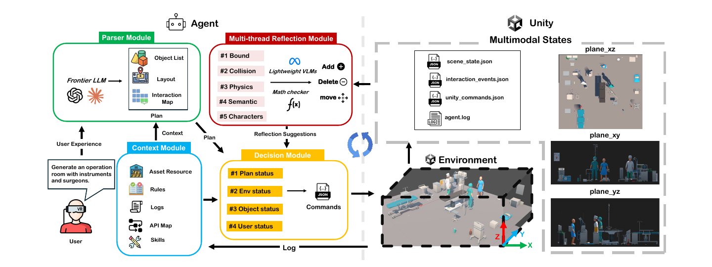

## TL;DR

Describe a healthcare training experience in plain English (for example, "generate an operation room with instruments and surgeons"), and the agent builds the **entire interactive VR scene** in Unity: objects, layout, characters, per-object interactions, and a sequential story line.

<figure>
  
  <figcaption>Environment generation pipeline: Parser, Context, Multi-Thread Reflection, and Decision modules in a closed loop with the Unity runtime</figcaption>
</figure>

**Key contributions:**

- A **multi-module agent architecture** (Parser, Context, Multi-Thread Reflection, Decision, Unity Operation) that lowers the authoring barrier for immersive medical visualization from code and 3D tooling to natural language.
- A **two-tier LLM design**: a frontier LLM handles a few high-leverage calls (scene synthesis, interaction map, story line), while lightweight VLM critics paired with deterministic checkers (Bound, Collision, Physics, Semantic, Characters) close the reflection loop over **three orthogonal screenshots**.
- An **LLM-free interaction layer**: an interaction map of per-object affordances and a strictly sequential story line are compiled to JSON up front, so runtime responses need no further LLM calls.
- Evaluated on **15 specialty-diverse healthcare-VR scenarios** (45 trials): the correct object set is recovered in every scene at **5.1 frontier-LLM calls** and **113 s** per trial, with story lines averaging **5.0 beats**.

## BibTeX

```bibtex
@inproceedings{chen2026description,
  title={From Description to Interactive VR Scene: An LLM Agent for Authoring Immersive Experiences},
  author={Chen, Rongqian and Andreyev, Allison and Wang, Xuan and Jiang, Jianan and Li, Bin and Lan, Tian},
  booktitle={IEEE VIS 2026 Workshop on Visualization and Generative AI (VIS x GenAI)},
  year={2026}
}
```
